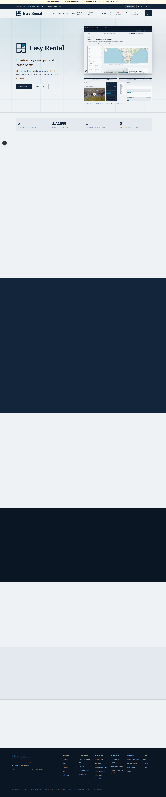
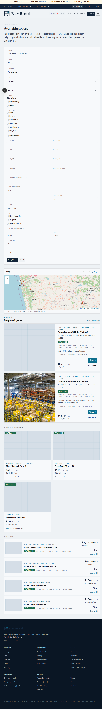
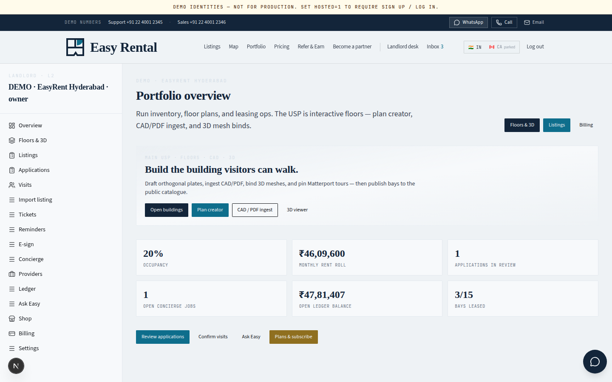
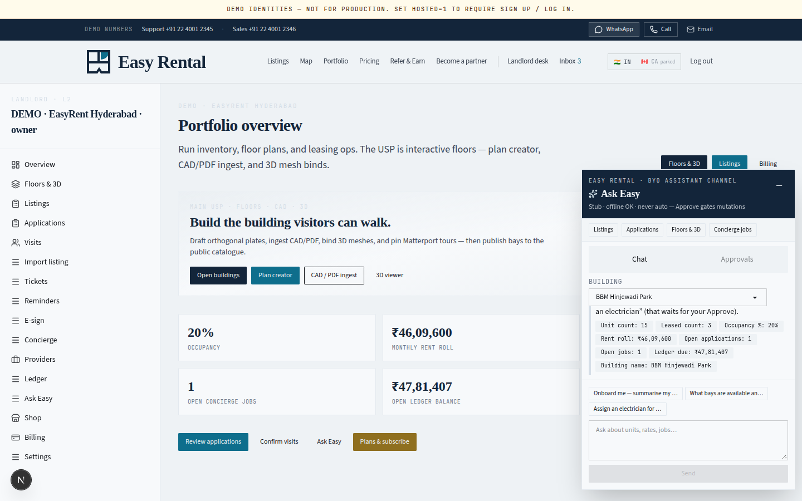
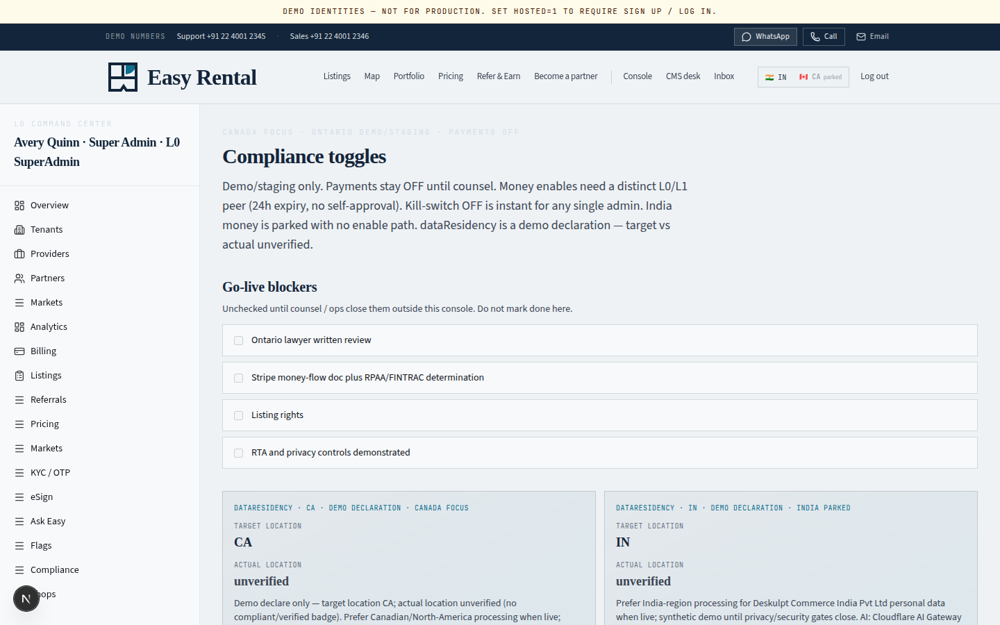

# Easy Rental


**Multi-tenant property ops and leasing for Ontario landlords** — listings, role desks, compliance gates, and Ask Easy in one PWA. A product of [DeSkulpt Inc](https://github.com/deskulpt) · [easyrental.space](https://easyrental.space)

> **Demo / staging posture.** This repository ships synthetic DEMO fixtures. **Payments stay OFF**, deposit-holding is never enabled, and go-live compliance blockers remain unchecked until counsel and dual-admin sign-off. It is not a live tenancy, credit decision, or payment account.

<p align="center">
  
</p>

<p align="center"><em>Canada marketing home (<code>/ca</code>) — brand-first hero over blueprint atmosphere.</em></p>

## Features

- **Listings marketplace** — filterable unit directory with map pins, media, and apply / visit flows
- **Role desks** — landlord, applicant, provider, CMS, and L0 command center (scoped by organisation)
- **Ask Easy** — floating assistant for onboard chat, drafts, and approval-gated mutations (stub without LLM keys)
- **CountryPack `/ca` · `/in`** — one UI, pack-swapped currency / tax / payments / lease templates; root picker never auto-redirects without consent
- **Ontario residential demo** — RTA-aware rails, Standard Lease templates, compliance console; **money and deposit holds flagged OFF**
- **3D / floor visuals** — plan creator, CAD/PDF ingest, mesh ↔ unit binds, Matterport show URLs
- **Installable PWA** — `app/manifest.ts` + service worker for standalone mobile use

## Screenshots

### Marketing home


*Country-segment home at `/ca` — Easy Rental mark, one headline, CTA pair, full-bleed blueprint grid.*

### Listings desk



*Public listings catalog with filters, Leaflet map, and seeded DEMO units.*

### Landlord desk



*Landlord portfolio overview — occupancy, applications, ledger, and floor / 3D building tools.*

### Ask Easy



*Ask Easy island on the landlord desk — retrieval over real SQLite attributes; mutations stay approval-gated.*

### Compliance console



*L0 command center · Compliance — Canada/Ontario demo focus, payments OFF, go-live blockers unchecked.*

## Tech stack

| Layer | Choice |
| --- | --- |
| App | Next.js (App Router), React, TypeScript |
| UI | Tailwind CSS, DaisyUI, shadcn/ui |
| Data | SQLite (`node:sqlite`) — first request seeds DEMO fixtures |
| Motion / maps | GSAP (marketing), Leaflet + OSM |
| PWA | Web app manifest + service worker |
| Tests | Vitest, Playwright |
| Optional compute | Rust WASM core (`packages/easyrent-wasm`) with TS fallback |

## Local run

```bash
git clone https://github.com/deskulpt/Property-Manager.git
cd Property-Manager
git checkout main
npm install
npm run dev
```

Open **http://127.0.0.1:43123/**

`npm run dev` runs `next dev -H :: -p 43123`. The first request creates `data/deskulpt.sqlite` and loads the labelled DEMO portfolio (gitignored).

```bash
npm run reset          # restore seed (stop the dev server first)
npm test               # Vitest suites
npm run test:e2e       # Playwright on port 43124 + throwaway DB
npm run build && npm start
```

See [`docs/setup.md`](docs/setup.md) and [`.env.example`](.env.example). Health: `GET /api/health`.

### Demo identity (local only)

In non-production, the demo identity switcher can impersonate seeded fixtures (e.g. landlord **Nadia**, Super Admin **Avery**). Never enable `DESKULPT_DEMO_SWITCHER` on a host that holds real landlord data. Hosted mode (`HOSTED=1`) turns the switcher off unless you explicitly opt in for staging.

## Honest limits

- **No live charges** — Stripe / Interac / Razorpay rails are gated OFF; ledger “paid” rows are local demo adapters
- **No deposit holding** — hard OFF; Ontario LMR rules are documented, not live money movement
- **Synthetic data** — DEMO · labelled fixtures on `.example` domains; do not upload real ID or card data
- **Ask Easy** — stub retrieval by default; optional model keys; real PII to AI stays blocked until flags flip
- **Go-live blockers** stay unchecked in the compliance console until written legal / finance evidence

## Docs

- [`docs/setup.md`](docs/setup.md) · [`docs/architecture.md`](docs/architecture.md) · [`docs/hosting-cloudflare-oci.md`](docs/hosting-cloudflare-oci.md)
- [`docs/ontario-demo-approval-nov7.md`](docs/ontario-demo-approval-nov7.md) · [`docs/compliance-feature-flags.md`](docs/compliance-feature-flags.md)
- [`docs/prd-unified-v1.md`](docs/prd-unified-v1.md) (proposed) · brand tokens in repo theme docs

Canonical repository: https://github.com/deskulpt/Property-Manager

## License

**MIT** — see [`LICENSE`](LICENSE). Copyright 2026 DeSkulpt contributors.

**Easy Rental** ([easyrental.space](https://easyrental.space)) is a product of **DeSkulpt Inc.**

GSAP is used under its standard commercial licence (not OSI). Other direct dependencies are OSI-licensed; see [`CREDITS.md`](CREDITS.md).
